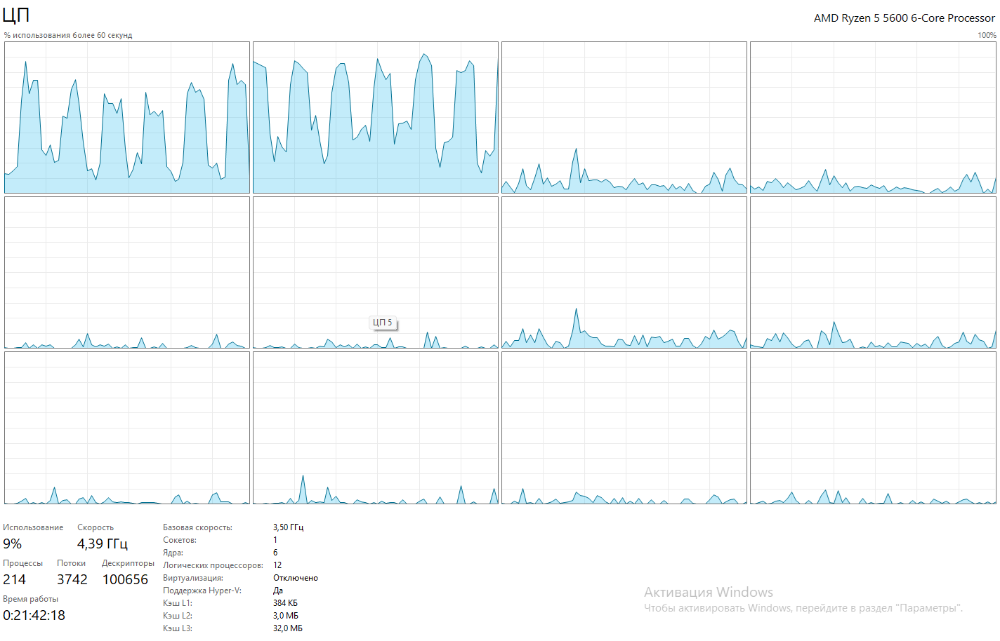

### Практическая работа №4
## 1
| Показатель | Значение |
| ---: | ---: |
| Физические ядра (Диспетчер задач) | 6 |
| Логические процессоры (Диспетчер задч) | 12 |
| Environment.ProcessorCount | 12 |

Вывод: эксперимент показал, что значение Логических процессоров совпадает со значением Environment.ProcessorCount. Подтвердилось предположение что .NET видит именно логические процессоры.
## 2

Вывод: эксперимент показал, что нагрузка от программы была видна на процессорах "ЦП 0" и "ЦП 1"

## 3
| Запуск | Режим | Итераций примерно за 1 секунду |
| ---: | ---: | ---: |
| 1 | Debug | 34 460 606 |
| 2 | Debug | 34 478 350 |
| 3 | Debug | 34 538 716 |
| 4 | Realise | 40 427 808 |
| 5 | Realise | 40 627 306 |
| 6 | Realise | 40 648 075 |

Вывод: эксперимент показал, что итераций в режиме Debug за 1 секунду меньше, чем итераций в режиме Realise. Подтвердиось предположение , что три результата не будут значительно отличаться друг от друга. А также подтвердилось то, что итераций за 1 секуду будет больше в режиме Realise.

## 4
Вычислительная мощность остальных ядер не «потерялась» — они в основном простаивали, потому что программа из Части 2 выполняла вычисления последовательно и не распределяла задачи между несколькими потоками; чтобы задействовать ядра параллельно, программу нужно специально распараллелить, если её задачи это позволяют.